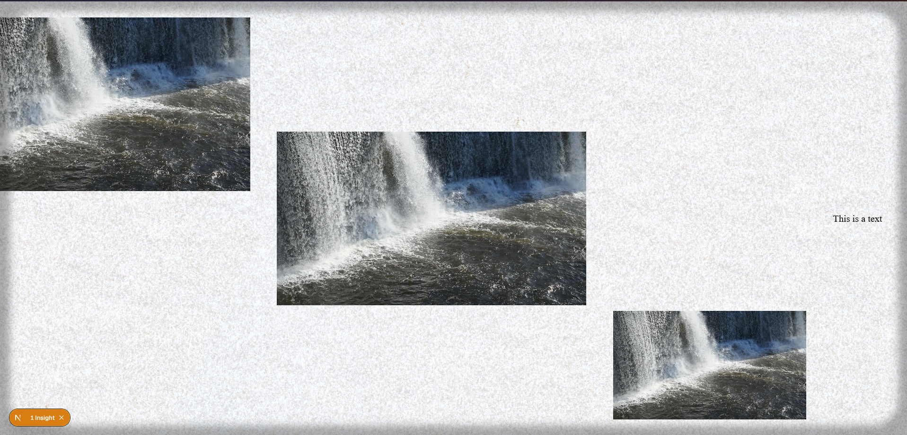
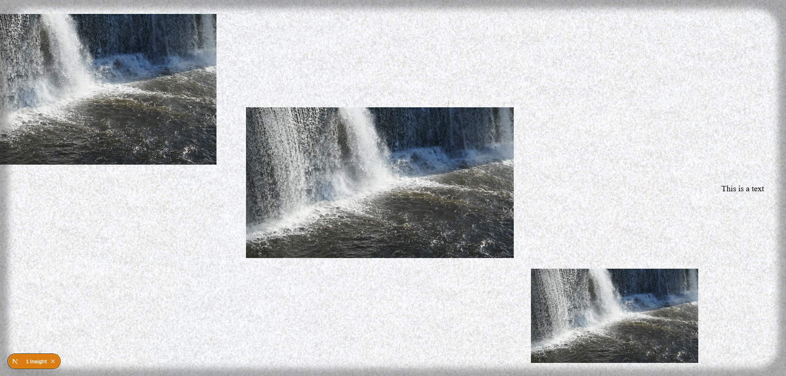
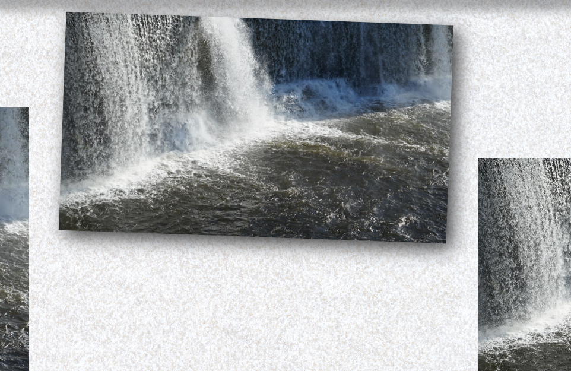

# CART-470
### Week 10) 18/11/26 - 24/11/26

### Studio Work
We had a meeting (+ reminder email) with VK to inform them of what we need from them to complete our first coding iteration, and by what deadline. We managed to keep this meeting rather short and on topic, now whether those deadlines will be met remains to be seen. Those deadlines are:
- Final image selection + final order / layout of content. Which means photos of paper scroll + video of paper scroll + individual images: Monday Nov. 23
- Background sound from Val: Monday Nov. 23
- Ink spiral(s) scans: Monday Nov. 30
- Project about + credits written out: not so much a priority but would be nice to include, sometime before the presentation Wednesday Dec. 2

### Home Work
As expected the mouse position-based effects were quick enough to code, taking barely a day to finish.

General position offset:

It's easier to see it live instead of with screenshots where the mouse cursor couldn't be captured, but the middle image moved slightly more up & to the right between the captures.

Hover offset:

Currently done with CSS, although there could be an alternative way to do it that adds some more variations to the rotation.

---

### Coming Up Next
- Final class presentation: Dec. 2

---

<b>[Prev. Entry](https://github.com/zettaMarge/CART-470/tree/W9-entry) --- [Back to main](https://github.com/zettaMarge/CART-470) ---</b> Next Entry

