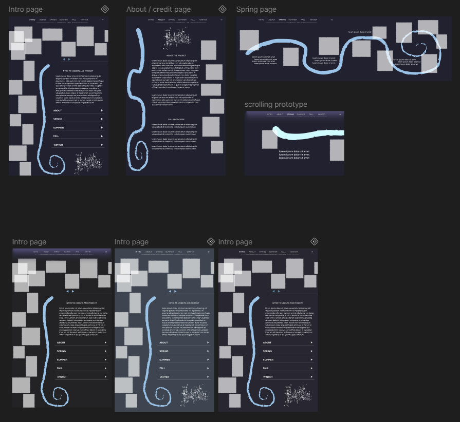

# CART-470
### Week 5) 07/10/26 - 06/20/26

### Studio Work
Class Meeting Recap:
- quick overview of how our last meeting with VK went
- presented our prototypes
    - mix & match kind of integration since we all had such different interpretations & focus in our prototypes
    - ex. have tatiana's as the outer view, mine as the inner/zoomed-in view
    - how feasible is a randomized flow/order
    - have the actual irl month/season affect the starting point?
- we need to have a more concrete organization of the seasons for a better flow, transitions, etc.
- important to consider how to balance the audio/video asstes if multiple ones are playing at the same time
- our goal for our meeting with VK later today is to have them choose which elements they want, know how they plan to add in content later on in the project (json file they can edit? with interface?)
- our plan going forward is to have a (mostly) concrete final Figma after reading week so we can move away from it, & make an initial selection of media we plan to use for it
- consider meeting with VK during reading week depending how today's goes

VK Meetup Recap:
- as expected, VK likes many elements from the different prototypes, trusts us to come up with a hybrid mashup of those ideas
    - horizontal and THEN vertical scrolling from mars' (visual and flow)
    - collaborators credit space + about page (snakes & ladders) from tatiana's
    - navigation + sound control from mine and tatiana's also
    - sparse images first, then more dense at waterfall
- no answer yet hosting-wise
- VK will be on campus during reading week from Oct 13 to 16-17 (possibly)
- next wednesday VK meeting is to meet more members of the project (Val & ??Casey?) and show a prototype hybrid WIP

### Home Work
hybridization of our ideas is going smoothly, however the transition of lower-to-higher fidelity is a bit more rough, especially for choosing a colour palette that works well with the assets that will be included. we also brainstormed the idea that the colours could switch with the seasons / scrolling, though would require careful work to choose colours that work well enough with each other while also respecting the previously made point.

the difference in feedback between last's week's meeting with VK and the one during reading week was incredibly jarring and disheartening considering we haven't really introduced any new elements between the two. We still managed to get some ideas on how to proceed with our current prototype, namely:
- lighter colour palette & different flow variations
- include actual pictures to replace the placeholders
- include the about/credits page as a frame/modal within the whole flow instead of a separate page
- keep the poems as image scans instead of text sections (sketchy/pencil notes aesthetic)

---

### Coming Up Next
- ~~Hybrid prototype wip 1) Oct. 14 @11:30 via Zoom~~
- Hybrid prototype wip 2) Oct. 21 @11:30 in person
- Milestone 1: mid/high-fidelity Figma prototype) Oct. 21

---

<b>[Prev. Entry](https://github.com/zettaMarge/CART-470/tree/W4-entry) --- [Back to main](https://github.com/zettaMarge/CART-470) ---</b> Next Entry

