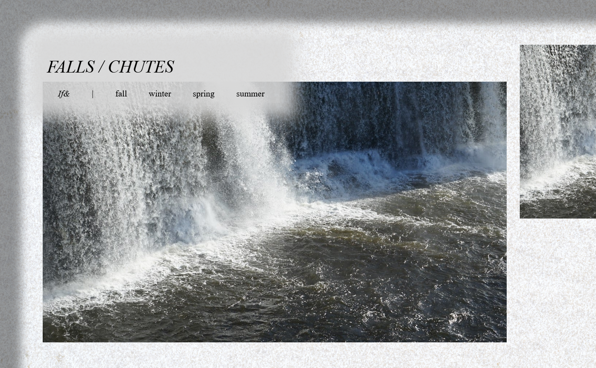
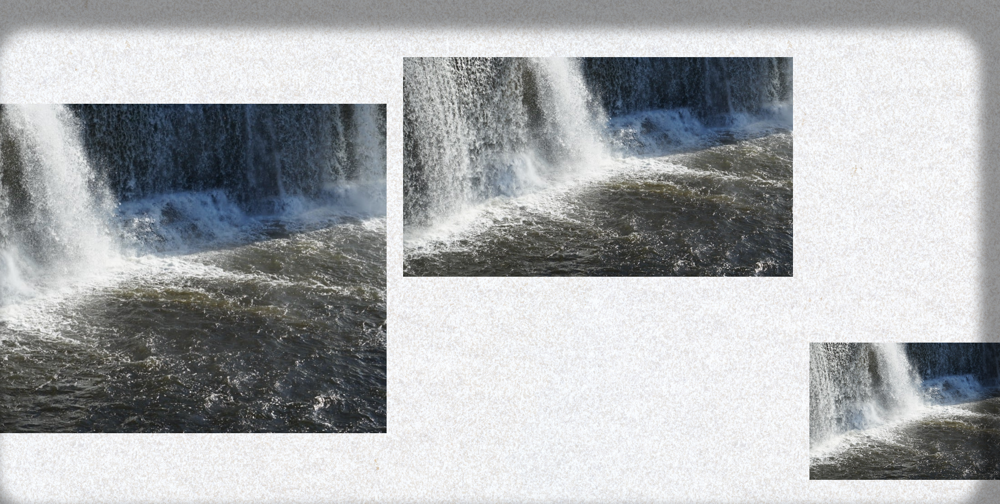
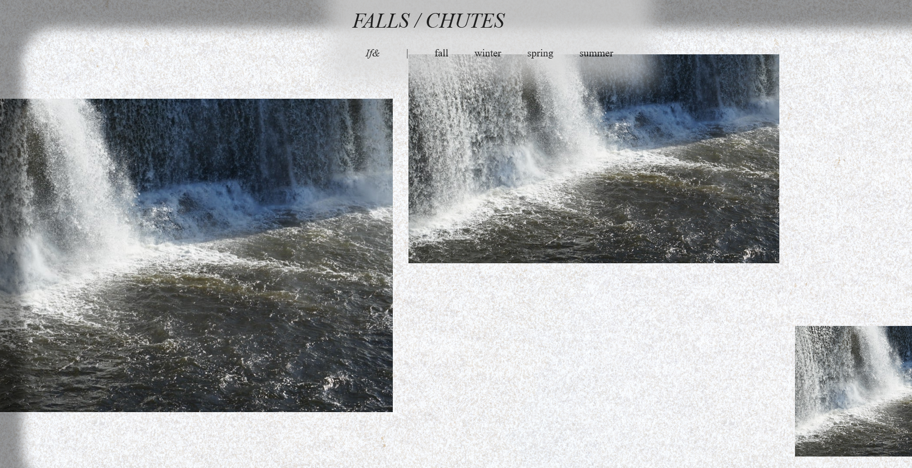

# CART-470
### Week 8) 04/11/26 - 10/11/26

### Studio Work
No work done during class as it was midterm presentation day for all the groups. Very glad to learn that final presentations will have a more "booth-like" format instead of in front of everybody.

### Home Work
While the disappearing navbar was easy enough to code & style as a component with a single given behaviour, it gets more complicated when that behaviour needs to change based on a separate component's state. Thankfully React provides a simple solution to this with Contexts, although it will still require some rework of the component I've made so far to work as intended. There are also some complications with it related to typescript causing errors when creating a new context without a default value or when setting this default to null, but I found a way to circumvent that.

Navbar at the start:

Navbar after scrolling a bit (non-hovered state):

Navbar after scrolling a bit (hovered state):

We still only got radio silence from VK in terms of the hosting situation, which is aggravating since much of the work left is backend-related and as such depends on the hosting being figured out. We do have an upcoming meeting scheduled with them at least.

---

### Coming Up Next
- VK meetup: Nov. 11 @10:30

---

<b>[Prev. Entry](https://github.com/zettaMarge/CART-470/tree/W7-entry) --- [Back to main](https://github.com/zettaMarge/CART-470) ---</b> Next Entry

